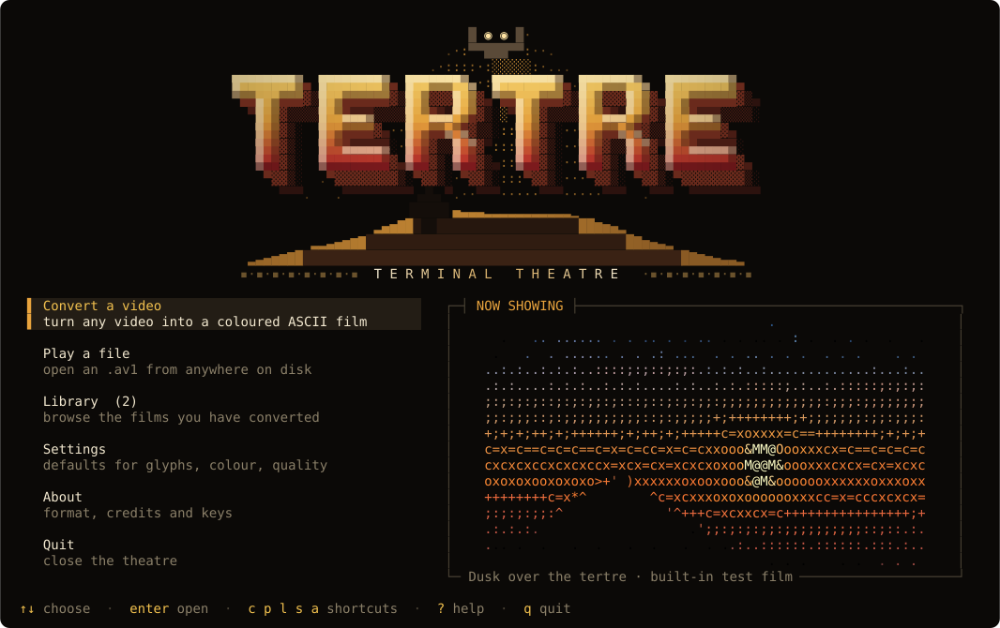
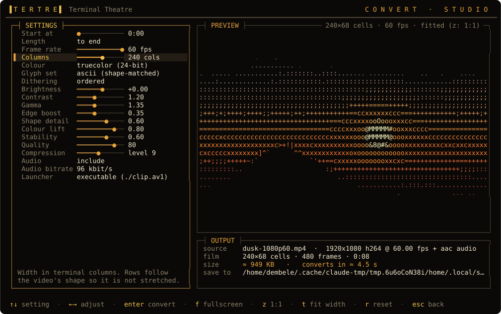
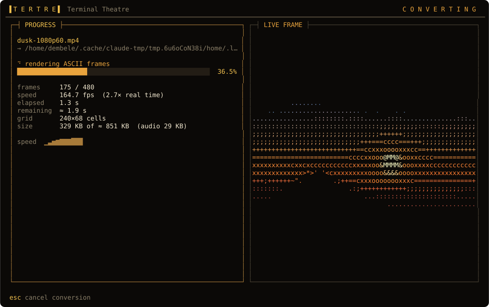
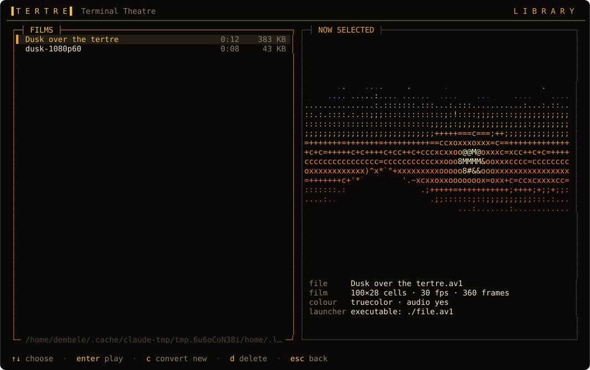
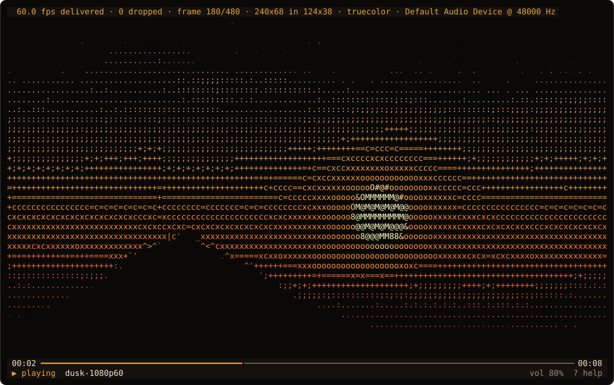
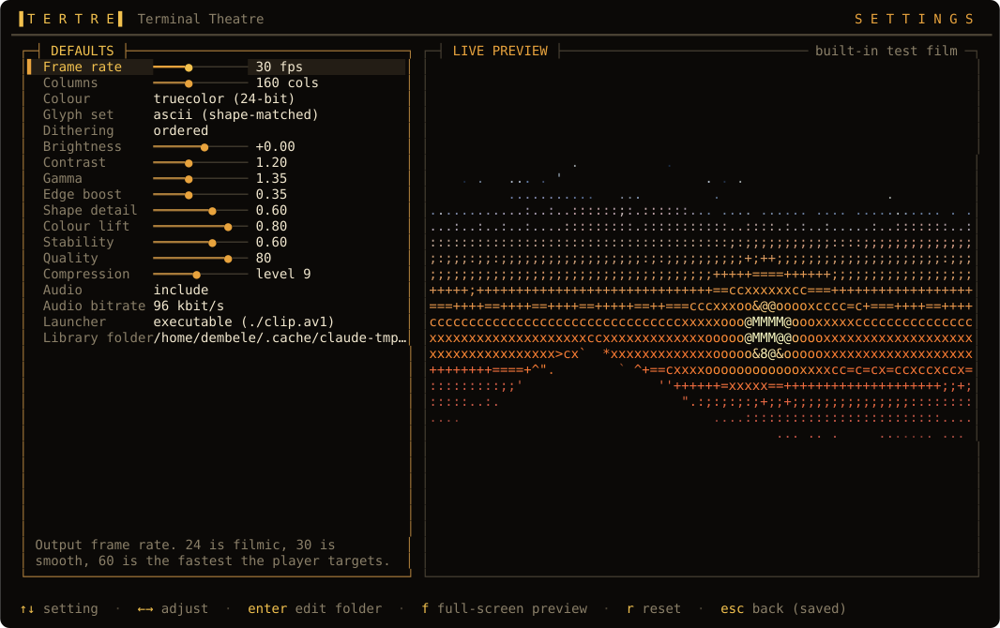
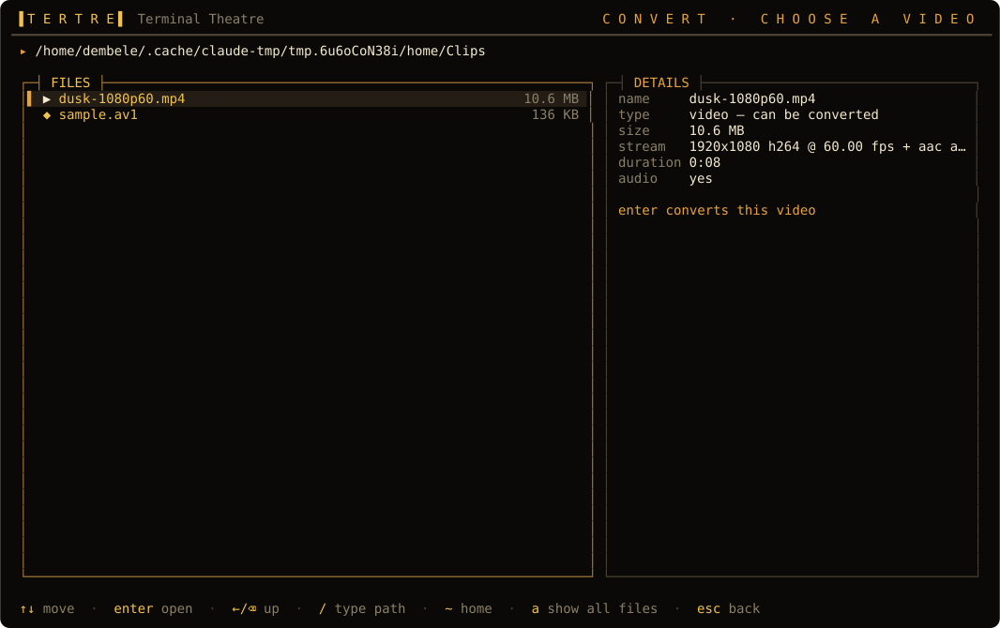

<p align="center">
  
</p>

<h1 align="center">tertre</h1>
<p align="center"><b>Terminal Theatre</b> — turn any video into a coloured ASCII-art film, and play it back with sound, in your terminal.</p>

<p align="center">
  <a href="https://github.com/sarja-technologies/tertre/actions/workflows/ci.yml"></a>
  
  
  
</p>

**tertre** is an open-source terminal cinema by [Sarja Technologies](https://github.com/sarja-technologies). It converts MP4, MOV, MKV, WebM — anything FFmpeg can read — into **ASCII Video 1** (`.av1`), a compact, seekable, checksummed film format with per-cell RGB colour and an embedded soundtrack, and plays those films back with paced frames, differential screen updates and audio-clock synchronisation. Everything is drawn with ordinary text characters and ANSI colours: no GUI window, no browser, no terminal image protocol.

```console
$ tertre convert cat-video.mp4        # video  -> ./cat-video.av1 (executable!)
$ ./cat-video.av1                     # …and just run it
$ tertre                              # or use the full-screen theatre
```

> **`.av1` here is not the AV1 video codec.** The name is a coincidence of history. Files in this format start with their own signature (`89 41 53 56 31 0D 0A 1A`, "ASV1"), which is how tertre — and anything else — tells them apart from real AV1 data. See [the format spec](docs/AV1-FORMAT.md).

## Contents

[Screens](#screens) · [Install](#install) · [Quick start](#quick-start) · [Example workflow](#example-media-workflow) · [The interface](#the-interface) · [Conversion settings](#conversion-settings) · [Playback](#playback) · [Command line](#command-line) · [The `.av1` format](#the-av1-format) · [How it works](#how-it-works) · [Measured results](#measured-results) · [Testing](#testing) · [Limitations](#limitations-read-this) · [Contributing](#contributing)

## Screens

Every image below is a real screenshot: the real `tertre` binary driven inside a pseudo-terminal, its output run through a terminal emulator ([`scripts/screenshots.sh`](scripts/screenshots.sh) regenerates them).

| | |
|---|---|
| <br>**Studio.** Settings on the left, a live ASCII preview of the section you will convert on the right, and an estimate of the output size and conversion time. | <br>**Conversion.** Progress, speed, ETA, bytes so far against the estimate, and the actual frame being written. |
| <br>**Library.** Your converted films, with a looping thumbnail and everything the file says about itself. | <br>**Player.** Truecolor playback with an on-screen display. <kbd>i</kbd> shows measured delivery stats. |
| <br>**Settings.** Defaults for every conversion option, previewed live on the built-in test film. | <br>**File picker.** Browse for a video; tertre probes the highlighted file as you move. |

## Install

tertre targets **Ubuntu / Linux** first. It needs [FFmpeg](https://ffmpeg.org) **only to convert**; playing `.av1` files needs nothing but the binary and (for sound) ALSA, PulseAudio or PipeWire.

```sh
# 1. dependencies (Debian/Ubuntu)
sudo apt install ffmpeg libasound2

# 2. tertre: prebuilt release, falls back to building from source
curl -fsSL https://raw.githubusercontent.com/sarja-technologies/tertre/main/install.sh | sh
```

The installer puts `tertre` in `~/.local/bin` (use `--system` for `/usr/local`, `--prefix DIR` for elsewhere), verifies the release's SHA-256, and warns about anything missing. `install.sh --uninstall` removes it.

**From source** (Rust 1.88+):

```sh
sudo apt install ffmpeg libasound2-dev pkg-config
cargo install --git https://github.com/sarja-technologies/tertre --locked
# or: git clone … && cargo build --release   →  target/release/tertre
```

Check your setup:

```console
$ tertre doctor
  [ok     ] ffmpeg   (needed for converting videos)
  [ok     ] ffprobe  (needed for converting videos)
  [ok     ] ffmpeg libvorbis encoder (audio tracks)
  [ok     ] audio output: Default Audio Device
  [ok     ] truecolor terminal (COLORTERM=truecolor)
```

For the best picture use a truecolor terminal (GNOME Terminal, Konsole, Kitty, WezTerm, Alacritty, foot, iTerm2, Windows Terminal…) at least 80×24 — the bigger the better.

## Quick start

```console
$ tertre demo                  # builds dusk.av1 from the built-in test film (no video needed)
$ tertre play dusk.av1         # play it
$ ./dusk.av1                   # …or run it: generated files are executable launchers
$ tertre                       # full-screen theatre: convert, browse, play, configure
```

A ready-made 6-second film ships in the repo: [`tests/fixtures/sample.av1`](tests/fixtures/sample.av1) (136 KB).

## Example media workflow

From a video file to a film you can run, with every step checked:

```console
# 0. get a source video (or use any MP4/MKV/MOV/WebM you have)
$ scripts/make-sample-mp4.sh sample.mp4        # 10 s, 640x360, H.264 + AAC

# 1. convert: 30 fps, 160 columns, truecolor, with sound
$ tertre convert sample.mp4 -o sample.av1 --fps 30 --cols 160
tertre: wrote sample.av1 — 160x45 cells, 300 frames, 10.0s, 613.2 KB (33.9 KB audio) in 0.5s

# 2. look inside
$ tertre info sample.av1
  grid        160 x 45 cells (cell aspect 0.50)
  timing      300 frames @ 30.000 fps = 10.00 s
  audio       Vorbis, 48000 Hz, 2 ch, 10.00 s, 33.9 KB (offset 0 us)
  launcher    standard tertre launcher (executable with ./file.av1)

# 3. prove it is intact: every chunk CRC, whole-file CRC, every frame decodes, audio matches video length
$ tertre verify sample.av1
ok: 300 frames, all chunk and file checksums valid, every frame decodes (content hash 5db3db9d)
ok: audio decodes (10.017 s) vs video 10.000 s: difference +17 ms

# 4. play it — as a file, or as a program
$ tertre play sample.av1
$ ./sample.av1 --loop

# 5. measure it without a terminal (CI-friendly): paced like a real run, JSON stats out
$ tertre play --headless --size 160x45 --stats-json sample.av1
```

Tune the look interactively with `tertre sample.mp4` (opens the studio on that file), or from the shell with the flags in [Conversion settings](#conversion-settings). `tertre preview sample.mp4 --at 5 --cols 100` prints one rendered frame to stdout.

## The interface

Run `tertre` for the full-screen theatre. A projector-lit splash runs real start-up checks (FFmpeg, audio device, terminal colour), then:

| Screen | What it does |
|---|---|
| **Convert a video** | Pick a file → *studio*: adjust every option and watch the preview re-render, see the estimated size and time, press <kbd>enter</kbd> to convert with live progress, then play the result. |
| **Play a file** | Browse to any `.av1` and play it full-screen. |
| **Library** | Films in your library folder with thumbnails and metadata; play or delete. |
| **Settings** | Default conversion settings (saved to `~/.config/tertre/config.toml`) with a live preview. |
| **About** | Format, credits, keys. |

Keys: <kbd>↑</kbd><kbd>↓</kbd> move · <kbd>←</kbd><kbd>→</kbd> adjust (<kbd>shift</kbd> for big steps) · <kbd>enter</kbd> select · <kbd>esc</kbd> back · <kbd>?</kbd> help on any screen. In the studio: <kbd>f</kbd> plays the preview full-screen, <kbd>z</kbd> toggles a 1:1 view of the real cell grid, <kbd>t</kbd> fits the columns to your terminal width, <kbd>r</kbd> resets.

## Conversion settings

| Setting | CLI flag | What it does |
|---|---|---|
| Frame rate | `--fps 24\|30\|60\|N` | Output rate (default 30). The source is resampled to constant frame rate. |
| Resolution | `--cols N` (16–480) | Terminal columns; rows follow from the video's shape and the cell aspect, so nothing is stretched. |
| Cell aspect | `--cell-aspect 0.5` | Cell width ÷ height of your font (≈ 0.5). |
| Colour | `--color truecolor\|256\|mono` | Full RGB, xterm-256 palette (exactly representable), or pure glyphs. |
| Glyph set | `--ramp ascii\|classic\|detailed\|blocks\|mixed` | `ascii`: 95 printable glyphs matched by *shape*; `classic`: ` .:-=+*#%@`; `detailed`: 70-step ramp; `blocks`: `░▒▓█▀▄▌▐…`; `mixed`: both. |
| Brightness / contrast / gamma | `--brightness` `--contrast` `--gamma` | Tone curve applied before glyph choice. |
| Dithering | `--dither none\|ordered\|diffuse` | Keeps smooth gradients smooth. |
| Edge boost | `--edge 0..1` | Unsharp mask before matching so outlines survive. |
| Shape detail | `--detail 0..1` | 0 = pure brightness ramp; 1 = strokes follow edges. |
| Colour lift | `--color-boost 0..1` | Brightens glyph colours so thin glyphs still read as the right hue. |
| Stability | `--stability 0..1` | Keeps a glyph unless another is clearly better: less shimmer, smaller files. |
| Quality | `--quality 0..100` | Colour precision and temporal dead-band. |
| Compression | `--compression 1..19` | zstd level; playback speed is unaffected. |
| Keyframes | `--keyframe-secs` | Seek granularity vs. size. |
| Audio | `--no-audio`, `--audio-kbps` | Include the soundtrack (Ogg Vorbis, 48 kHz stereo). |
| Launcher | `--no-launcher` | Skip the `./file.av1` shell header (then the file is not executable). |
| Range | `--start S --duration S` | Convert just a section. |

**How a frame becomes ASCII.** Each terminal cell covers a 4×8 patch of the (supersampled) source frame. The renderer applies the tone curve and edge boost, then scores glyphs against the patch: smooth cells use a monotone *tone ladder* of calm glyphs, dithered; cells with real structure may use any *stroke* glyph (`| / \ _ - ' ( ) …`) whose measured shape (rasterised from DejaVu Sans Mono) best follows the local edge at the right ink level. A glyph is kept from frame to frame unless another is clearly better. The glyph's colour is the average source colour *under its ink*, lifted towards full value so it reads correctly on black. Aspect ratio is handled by sampling a 1:2 patch per cell.

## Playback

```console
$ tertre play cat-video.av1          # or simply:  tertre cat-video.av1
$ ./cat-video.av1                    # self-launching file (needs tertre installed)
```

| Key | |
|---|---|
| <kbd>space</kbd> | pause / resume |
| <kbd>←</kbd> <kbd>→</kbd> | seek ∓5 s (<kbd>shift</kbd>: ∓30 s, <kbd>j</kbd>/<kbd>l</kbd>: ∓10 s) |
| <kbd>↑</kbd> <kbd>↓</kbd> / <kbd>+</kbd> <kbd>-</kbd>, <kbd>m</kbd> | volume, mute |
| <kbd>,</kbd> <kbd>.</kbd> | step a frame back / forward while paused |
| <kbd>0</kbd>…<kbd>9</kbd>, <kbd>home</kbd>, <kbd>end</kbd> | jump to 0–90 %, start, end |
| <kbd>i</kbd> | stats overlay: **measured** delivered fps, dropped frames, sizes |
| <kbd>r</kbd> | loop |
| <kbd>?</kbd>, <kbd>q</kbd> / <kbd>esc</kbd> / <kbd>ctrl-c</kbd> | help, quit (always restores your terminal) |

What the player does:

* **Alternate screen**, hidden cursor, autowrap off, all restored on exit, on Ctrl+C, on `kill`, and on panic.
* **Audio is the master clock.** Frames are scheduled against the sample the speakers are playing now (device position minus reported output latency), smoothed between callbacks. Seeking flushes and re-aligns both.
* **Differential updates.** Only changed cells are written, runs are coalesced, colour codes are emitted only on change, and each frame is wrapped in a synchronised-update pair (DEC 2026) so supporting terminals never tear.
* **Dropped frames, honestly.** A dedicated writer thread does all terminal I/O. If the terminal has not accepted the previous frame, the next one is *skipped, not queued* — latency stays flat — and counted. If the clock has moved past frames, they are skipped (but still decoded, so deltas stay correct) and counted. The summary printed on exit and the <kbd>i</kbd> overlay report frames **delivered per second of playing time**; nothing is ever labelled "60 fps" unless it was measured as 60.
* **Adaptive resizing.** On `SIGWINCH` the screen is cleared and the picture re-fitted: footage larger than the terminal is box-resampled down (glyph and colour chosen from the covered cells), never cropped or wrapped; smaller footage is centred.
* **Colour fallback.** A truecolor file on a terminal without 24-bit colour is mapped to the xterm-256 palette automatically (`--colors auto|truecolor|256|mono` to override).

## Command line

```text
tertre                         full-screen interface
tertre FILE.av1                play      ·  tertre VIDEO.mp4   open the converter on that video
tertre play FILE.av1 [--no-audio] [--volume N] [--loop] [--start S] [--colors …] [--hud]
                     [--headless [--size WxH] [--throttle-bps N] [--max-seconds S]] [--stats-json]
tertre convert VIDEO [-o OUT.av1] [settings…] [--start S --duration S] [-q]
tertre info FILE.av1 [--json]  everything stored in the file; flags non-standard launcher headers
tertre verify FILE.av1         all checksums, every frame decodes, audio length matches video
tertre library                 list the library folder
tertre demo [-o dusk.av1]      the built-in test film (needs ffmpeg only for the audio track)
tertre preview FILE [--at S]   print one rendered frame to stdout
tertre doctor                  check FFmpeg, audio output and terminal capabilities
```

Config lives in `~/.config/tertre/config.toml`; the default library is `~/.local/share/tertre/library`.

## The `.av1` format

A versioned binary container, fully specified in **[docs/AV1-FORMAT.md](docs/AV1-FORMAT.md)**:

```text
[#!/bin/sh launcher]  89 41 53 56 31 0D 0A 1A · version
HEAD  grid size, frame rate (rational), colour mode, glyph table (UTF-8)
META  JSON: title, source, producer, the settings used
AUDI  Ogg Vorbis (or reserved PCM) + start offset, streamed straight out of the file
FRAM× keyframes and delta frames: planar glyph + R/G/B, left-delta/prev-delta filtered, zstd, µs timestamp
INDX  every frame's timestamp, offset, keyframe flag (zstd)   → O(log n) seeking
FOOTER index pointer, frame count, CRC-32 of the whole body, end signature
```

* **Unique signature** — never confused with AV1 codec data (or IVF, Matroska, MP4, Ogg).
* **Sequential decode is cheap** — verifying and decoding 600 frames of 160×45 takes ~50 ms.
* **Integrity** — CRC-32 on every chunk, plus the whole body; truncated/unfinished files lack a footer and are rejected; conversions are written to `*.part` and renamed on success.

### Self-launching files, safely

Generated files start with a six-line `#!/bin/sh` header that does `exec tertre play "$@" -- "$0"`, and are `chmod 755`, so `./cat-video.av1 --loop` works. **The header is the only thing that runs.** tertre never executes anything from a file: `play`, `info`, `verify` and the TUI *skip* the header and parse the container; the video payload is only ever fed to a checksum, zstd and the frame decoder. Because anyone can put a different `#!` header on a file, `tertre info` tells you whether it is byte-identical to the standard launcher and warns loudly if not — only run `./file.av1` for files you trust, while `tertre play file.av1` is always safe. (Disable the header with `--no-launcher`.) This behaviour is covered by a test that plants a hostile header and checks that tertre never runs it.

## How it works

```text
  video ──ffmpeg──▶ rgb24 frames (cols·4 × rows·8) ──▶ render (rayon, per row band) ──▶ encode ──▶ .av1
          (scale, fps)                                  tone · edge · glyph match        delta + zstd
                                                        · dither · stability · colour
  audio ──ffmpeg──▶ 48 kHz stereo Ogg Vorbis ──────────────────────────────────────────▶ AUDI chunk

  .av1 ─▶ index ─▶ decode (keyframe + deltas) ─▶ fit & compose ─▶ diff vs. screen ─▶ writer thread ─▶ tty
                                  ▲                  (OSD overlay)                     (drops if busy)
            audio device clock ───┘   Vorbis ─▶ ring buffer ─▶ cpal callback ─▶ speakers
```

* **Conversion** is a three-stage pipeline (FFmpeg reader → data-parallel renderer → encoder/writer) with small bounded channels, so memory stays flat regardless of video length.
* **Rust**: `ratatui`/`crossterm` for the interface, `rayon` for rendering, `zstd`, `symphonia` (pure-Rust Vorbis decoding) and `cpal` for audio output. FFmpeg is a subprocess used for demuxing/scaling/audio encoding.
* The source is organised as: `format`/`codec` (the format), `render`/`glyphs` (glyph mapping), `convert`/`media` (pipeline), `player`/`display`/`audio`/`term` (playback), `tui/*` (interface).

## Measured results

Measured on the development machine (Linux, 16 hardware threads, the default ALSA output device). Reproduce with the commands shown. Your numbers will differ.

| What | Result |
|---|---|
| Convert 10 s of **1080p60** H.264 → 160×45 @ 60 fps with audio | **3.1 s** wall (≈190 frames/s, ≈3× real time); 240 columns: 5.2 s |
| Resulting file | 436 KB (357 kbit/s) incl. 35 KB audio; the same clip at 30 fps: 349 KB |
| Verify + decode all 600 frames | 52 ms |
| Playback, 600 frames @ 60 fps, **real audio device**, 160×45 (3 runs) | 600 / 600 frames delivered, **0 dropped**, 59.7 fps over the 10.04 s of play time, mean lateness ≤ 0.006 ms, worst frame ≤ 2.3 ms late, 0 audio underruns |
| Terminal output for that clip | 0.57 MB/s (the grainy test film in the test-suite needs up to ~0.9 MB/s) |
| Slow terminal (simulated 3–40 KB/s sink) | reported as exactly that: busy-drops counted, delivered fps ≪ 60 |
| Audio/video alignment inside converted files | white-flash frame and tone onset both land at 1.000 s (test tolerance 70 ms) |
| Audio clock vs. wall clock (`examples/audioclock.rs`) | callbacks every 10.7 ms, reported output latency a steady 32 ms, worst deviation from wall-clock rate 2.2 ms after start-up |
| Audio seek accuracy | within 0.02 of the continuous decode after seeking (sample-accurate; tested) |

```console
$ tertre play --headless --size 160x45 --stats-json clip.av1      # delivered_fps, dropped_late, dropped_busy, mean_late_ms …
```

## Testing

```console
$ cargo test --release            # 55 unit tests + 18 end-to-end tests
$ TERTRE_REQUIRE_FFMPEG=1 cargo test --release   # (CI) fail instead of skipping when ffmpeg is missing
```

* **Unit tests** — container read/write, corruption and truncation detection, versioning, launcher detection; frame codec round-trips (lossless and lossy, keyframes/deltas); glyph tables; renderer behaviour (tone monotonicity, edge → stroke, colour modes, palette exactness, dithering, stability, aspect ratio); the differential presenter against an in-tree terminal emulator; the frame pacer and audio clock smoother with synthetic time; settings and form bounds; the logo.
* **End-to-end tests** (`tests/e2e.rs`) — real FFmpeg: MP4 → `.av1` geometry/timing, 24/30/60 fps, frame-exact random access across keyframes, an A/V sync clip (white flash + tone onset), sample-accurate audio seeking, mono/256/truecolor, quality & compression trade-offs, range conversion, junk input; the real binary: 60 fps pacing accounting (presented + dropped = total), honest reporting on a throttled sink, `--start` seeking, the shipped fixture, the self-launching `./file.av1` (mode, argument forwarding, missing-install message), the never-execute-payload guarantee; and **real pseudo-terminals**: alternate-screen/cursor restore, `q` and Ctrl+C exits, SIGWINCH resizing (redraw + re-fit), pause/seek/jump/frame-step keys.
* **CI** (`.github/workflows/ci.yml`) runs fmt, clippy (`-D warnings`), the full suite on Ubuntu 22.04 and 24.04 with real FFmpeg, and shellchecks the installer.

## Limitations (read this)

tertre is a first release. What is and is not verified:

* **Linux only.** Developed and tested on Ubuntu. The core is portable Rust, but macOS and Windows are untested (and the `./file.av1` launcher is Unix by nature). Wayland/X11 don't matter — only the terminal does.
* **"Delivered" means the terminal accepted the bytes**, i.e. the write to the pty completed. That is real back-pressure from your terminal emulator, but it does not measure when pixels reach your monitor; GPU compositing and display latency are outside what a TUI can observe. I have not benchmarked individual terminal emulators — if yours is slow, the <kbd>i</kbd> overlay will say so. 60 fps of 160×45 truecolor is roughly 0.5–1 MB/s of escape codes: fine on modern GPU terminals, not on a slow SSH link.
* **Audio sync is verified at the file level and for clock stability, not by ear or by loopback.** The test-suite proves audio and video share a timeline in converted files and that seeking is sample-accurate; the audio clock was measured against the wall clock on one machine's ALSA/PipeWire device. Playback relies on the latency your audio stack reports (Bluetooth and some USB devices report it poorly). CI machines have no audio device, so CI exercises the wall-clock fallback instead.
* **Audio is Ogg Vorbis only** (48 kHz stereo; mono sources are upmixed). Converting with sound needs an FFmpeg built with `libvorbis` (Ubuntu's is); otherwise use `--no-audio`. If the audio device cannot be opened, playback continues silently and says so.
* **Source handling:** the first video stream and first audio stream; variable-frame-rate sources are resampled to constant frame rate; subtitles are ignored; HDR is not tone-mapped; very odd pixel formats depend on FFmpeg.
* **Glyph rendering assumes your font is roughly DejaVu-Sans-Mono-like** (shape templates were rasterised from it). Other monospace fonts work, the "shape matching" is just slightly less accurate. Block-element glyphs (`░▒▓█`) are *ambiguous width* in some East-Asian locales/terminals.
* **Terminals without synchronised output (DEC 2026)** may show tearing on busy frames; terminals that do not advertise truecolor get the 256-colour mapping.
* **Resizing smaller box-resamples the character grid** (it does not re-render from the source), so a very small window gives a coarse picture; larger windows centre the film instead of enlarging it.
* The `.av1` **PCM audio codec id is reserved but not written or played** by this version.
* An audio underrun (starved device) pauses the audio-derived clock, so video may stall briefly rather than drift.
* The terminal UI needs at least 80×24.

## Contributing

Issues and pull requests are welcome. `cargo fmt`, `cargo clippy --all-targets -- -D warnings` and `cargo test --release` should pass; the format changes of any kind go through [docs/AV1-FORMAT.md](docs/AV1-FORMAT.md) first. `tools/gen_glyphs.py` regenerates the glyph shape table; `scripts/screenshots.sh` regenerates the images above.

## License

[MIT](LICENSE) © 2026 Sarja Technologies. The ASCII-art logo, the format name *ASCII Video 1* and the *Terminal Theatre* descriptor belong to the same project and are covered by the same licence.
